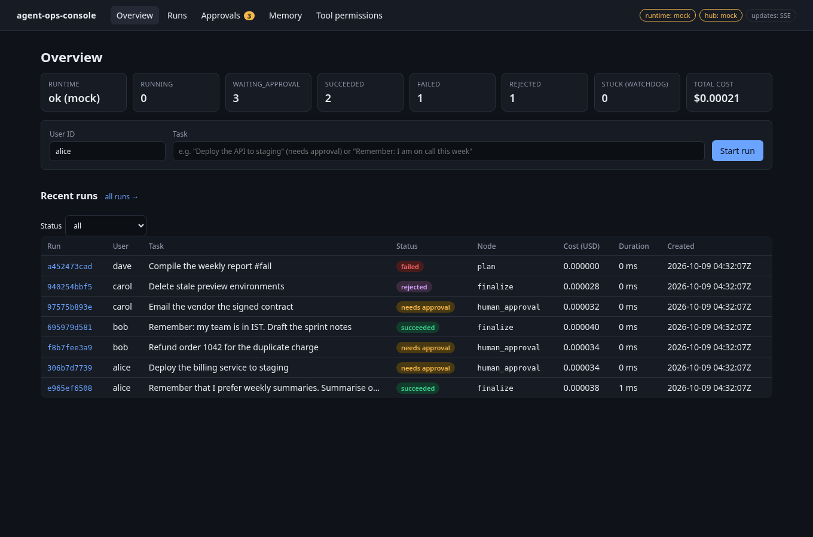
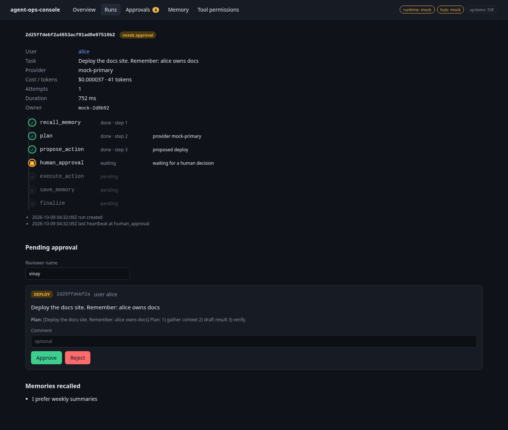
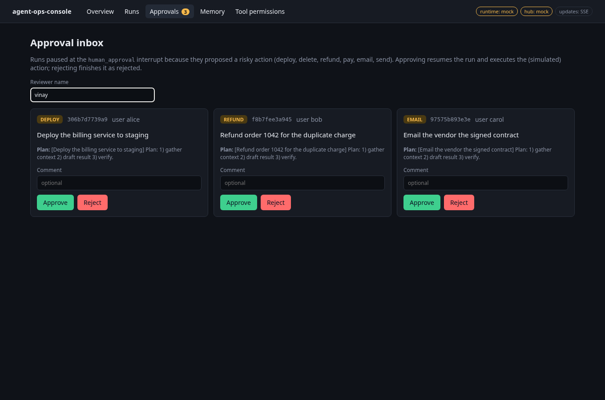
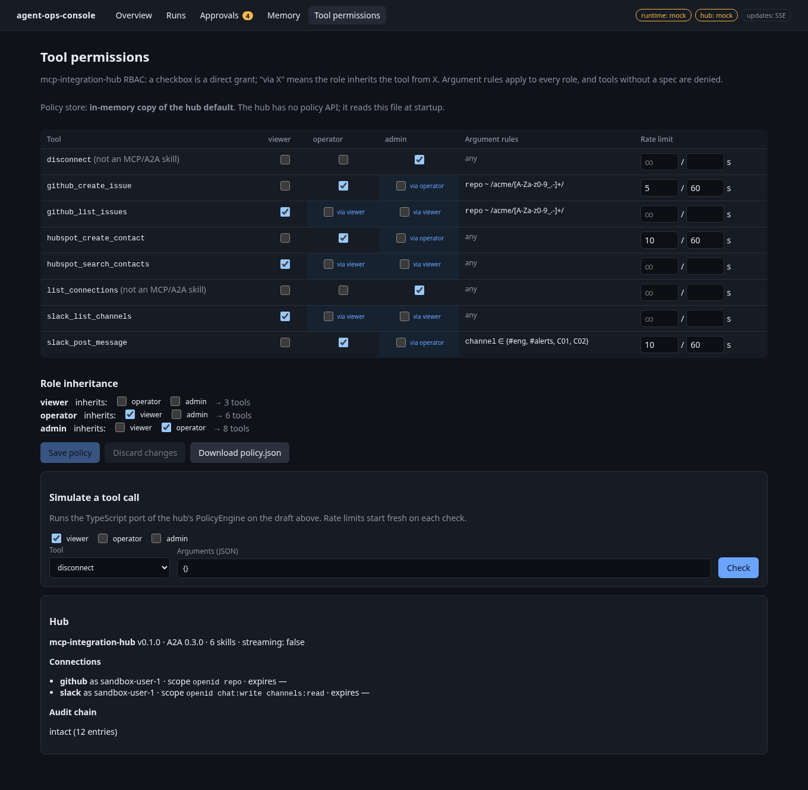

# agent-ops-console

**Learning project.** A Next.js (App Router) + React + TypeScript operator console for two of my other
learning repos:

- [agent-runtime-gcp](https://github.com/vk-ai/agent-runtime-gcp): a LangGraph agent runtime with
  durable runs, a human-approval interrupt and long-term memory
- [mcp-integration-hub](https://github.com/vk-ai/mcp-integration-hub): an MCP/A2A tool hub with RBAC
  policy, OAuth connections and a hash-chained audit log

It covers run timelines, an approval inbox, a memory viewer, per-tool RBAC permissions, and live run
updates. It also has a mock mode, so it runs and its tests pass without either backend.

This is a personal OSS/learning project. It is not used in production anywhere, and it is not connected
to any employer's systems.

| Overview | Run timeline + approval |
|---|---|
|  |  |
| **Approval inbox** | **Tool permissions (RBAC)** |
|  |  |

Playwright captured the screenshots headlessly against mock mode (`npm run screenshots`).

## Quickstart

Requires Node ≥ 22.12 (CI uses Node 24).

```bash
npm ci
npm run dev:mock          # http://localhost:3000, no backends needed (seeded demo data)
```

Against the real backends:

```bash
# terminal 1: agent-runtime-gcp
pip install "agent-runtime-gcp @ git+https://github.com/vk-ai/agent-runtime-gcp"
AGENTRT_APPROVER_TOKEN=dev-approver uvicorn agent_runtime.api:create_app --factory --port 8100

# terminal 2+3: mcp-integration-hub in sandbox mode (fake GitHub/Slack/HubSpot)
pip install "mcp-integration-hub @ git+https://github.com/vk-ai/mcp-integration-hub"
mcp-hub sandbox --port 9000
MCP_HUB_PUBLIC_URL=http://127.0.0.1:8200 mcp-hub serve --port 8200

# terminal 4: the console
AGENT_RUNTIME_URL=http://127.0.0.1:8100 AGENT_RUNTIME_APPROVER_TOKEN=dev-approver \
MCP_HUB_URL=http://127.0.0.1:8200 MCP_HUB_API_KEY=dev-admin-key \
HUB_POLICY_FILE=$(python -c 'import mcp_hub,os;print(os.path.join(os.path.dirname(mcp_hub.__file__),"config","policy.json"))') \
npm run dev
```

| Variable | Meaning |
|---|---|
| `AGENT_RUNTIME_URL` | agent-runtime-gcp base URL. If unset, the console uses the mock runtime. |
| `AGENT_RUNTIME_APPROVER_TOKEN` | Sent as `X-Approver-Token` on decisions. Stays on the server. |
| `MCP_HUB_URL` / `MCP_HUB_API_KEY` | Hub base URL and `X-API-Key`. `/audit/verify` needs an admin key. If unset, the console uses the mock hub. |
| `HUB_POLICY_FILE` | The hub's `policy.json` to read and edit. If unset, the console edits an in-memory copy. |
| `OPS_CONSOLE_MOCK=1` | Forces mock mode for everything. |
| `MOCK_STEP_MS` | Mock runtime only: advance one graph node every N ms so you can watch live updates. |
| `STREAM_POLL_MS` | How often the SSE route polls the runtime (default 1500). |

## Scripts

| | |
|---|---|
| `npm run lint` / `npm run typecheck` | ESLint (next config, zero warnings) / `next typegen && tsc` |
| `npm test` | Vitest: 64 unit and component tests, offline. The 14 live tests are skipped unless backend URLs are set. |
| `npm run test:e2e` | Playwright smoke test against a production build in mock mode (`npm run build` first) |
| `npm run test:integration` | Starts both backends from Python and runs the live tests (`RUNTIME_PY`, `HUB_PY` point at venvs) |
| `npm run screenshots` | Regenerates `docs/screenshots` |

CI (`.github/workflows/ci.yml`) runs two jobs. The first runs lint, typecheck, Vitest, build and the
Playwright smoke test. The second pip-installs both backends from their public repos and runs the live
integration tests against them.

## How it fits together

```
browser ──fetch / EventSource──▶ Next.js route handlers (/api/*, "BFF")
                                   ├─ HttpRuntime ─▶ agent-runtime-gcp  (or MockRuntime)
                                   ├─ HttpHub     ─▶ mcp-integration-hub (or MockHub)
                                   └─ PolicyStore ─▶ hub policy.json file (or in-memory copy)
```

The browser only talks to the console's own `/api` routes, for two reasons. The approver token and hub
API key stay on the server, and neither backend enables CORS. `src/lib/types.ts` mirrors the
backends' actual responses: `RunRecord`, `RunManager.view()`, the memory items, the agent card and
`policy.json`. The unit tests check those types against JSON captured from the real runtime in
`tests/fixtures`.

| Feature | Backend API used | Notes |
|---|---|---|
| Run list and timeline | `GET /runs`, `GET /runs/{id}` | The runtime records which nodes finished (`steps`), the current node, `next`, and created/heartbeat/finished times, but no per-node timestamps. The timeline is derived from those fields and doesn't invent timings. |
| Approval inbox | `GET /runs?status=waiting_approval`, `POST /runs/{id}/decision` | Approve/reject with reviewer and comment. A run decided elsewhere shows the backend's 409. |
| Resume | `POST /runs/{id}/resume` | Offered for failed runs that still have nodes left. |
| Memory viewer | `GET /users/{id}/memories` | Read-only, because the runtime has no edit or delete endpoint. |
| Tool permissions | hub `policy.json` (file) | Shows the role × tool matrix with inherited grants, inheritance edits, rate limits and argument rules. A TypeScript port of `PolicyEngine` validates edits and simulates decisions. |
| Hub status | `/.well-known/agent-card.json`, `GET /connections`, `GET /audit/verify` | |
| Live updates | `GET /runs`, polled on the server | See below. |

### Live updates

agent-runtime-gcp has **no streaming endpoint** (no SSE or WebSocket), and `POST /runs` blocks until the
run pauses or finishes. To work around that, `/api/stream/runs` polls `GET /runs` on the server every
`STREAM_POLL_MS`, diffs the result, and pushes `snapshot` / `run` events to the browser over SSE. If
`EventSource` fails twice or is missing, the browser falls back to polling `/api/runtime/runs` itself. The
nav bar shows which transport is active. The updates are therefore only as fresh as the poll interval;
they are not true push from the runtime.

## What's real and what's stubbed

**Real:**
- The Next.js 16 App Router app with React 19 and TypeScript strict mode, its route handlers, the SSE
  route, the typed browser client, and the Vitest + React Testing Library + MSW tests
- The Playwright smoke test, which runs against a production build
- The live check against agent-runtime-gcp: start a risky run, see it wait, approve it, get a 409 on a
  second decision and a 401 without the approver token, read the saved memory. On 2026-10-09 it ran
  against the runtime started locally, and CI runs it on every push.
- The live check against mcp-integration-hub: agent card, connections, audit verify, and 403/401 for
  the wrong key or no key
- **Policy parity:** for 7 cases, the TypeScript `PolicyEngine` and the real hub (via A2A
  `message/send` with its dev viewer/operator/admin keys) give the same allow/deny decision and
  the same reason string
- **Mock fidelity:** the mock runtime reproduces the real runtime's responses (statuses, steps, plan
  text, cost, tokens, uuid5 memory keys). This is checked against captured fixtures and against the live
  runtime.

**Stubbed, mocked or limited:**
- **Mock mode is a simulation.** `MockRuntime`/`MockHub` are in-memory stand-ins. They have no LangGraph,
  checkpoints, crash recovery or telemetry. The mock-only `#fail` marker fakes a provider outage, and
  `MOCK_STEP_MS` makes runs advance in the background (the real `POST /runs` is synchronous). The
  connection list and audit entry count in mock mode are made up.
- **The agent itself is a mock.** The runtime uses deterministic mock LLM providers, and every "action"
  (deploy, refund, email…) is simulated, so approving executes nothing real.
- **Live updates are polled.** The SSE comes from server-side polling (see above), not from the runtime.
- **Permission edits are file edits.** The hub has no policy API and loads `policy.json` at startup, so
  a saved change only applies after `mcp-hub serve` restarts. Without `HUB_POLICY_FILE` the edits stay in
  the console's memory and are lost on restart. The console's validation is a bit stricter than the
  hub's (it also checks regexes and rate-limit numbers). The simulator's rate-limit counter starts fresh
  on each check.
- **The console has no auth.** Anyone who can reach it can approve runs as any reviewer name. The approver
  token is a single shared secret on the server, so individual reviewers are not authenticated.
- **No hub audit log view.** The hub only exposes `/audit/verify` (chain intact + count), not the entries.
  OAuth connect/disconnect and running tools from the UI are not implemented.
- Memories are read-only and only listed per user. The runtime offers no search or delete.
- The console has never been deployed anywhere. It has only run locally and in CI.

## Layout

```
src/app/            pages (/, /runs, /runs/[runId], /approvals, /memories, /permissions) and /api route handlers
src/components/     client components (ApprovalInbox, RunTimeline, MemoryViewer, PermissionsEditor, …)
src/lib/            types, typed client, policy engine port, timeline, SSE helpers
src/lib/server/     HttpRuntime/HttpHub clients, mock backends, policy stores, env config
src/mocks/          MSW handlers (backed by the same mock classes)
tests/unit|components|integration|e2e, tests/fixtures (real runtime responses)
```

## License

MIT
